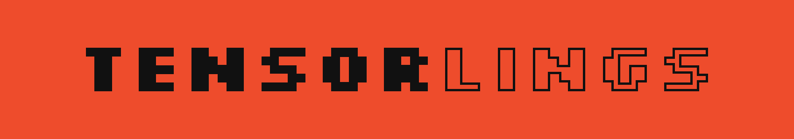
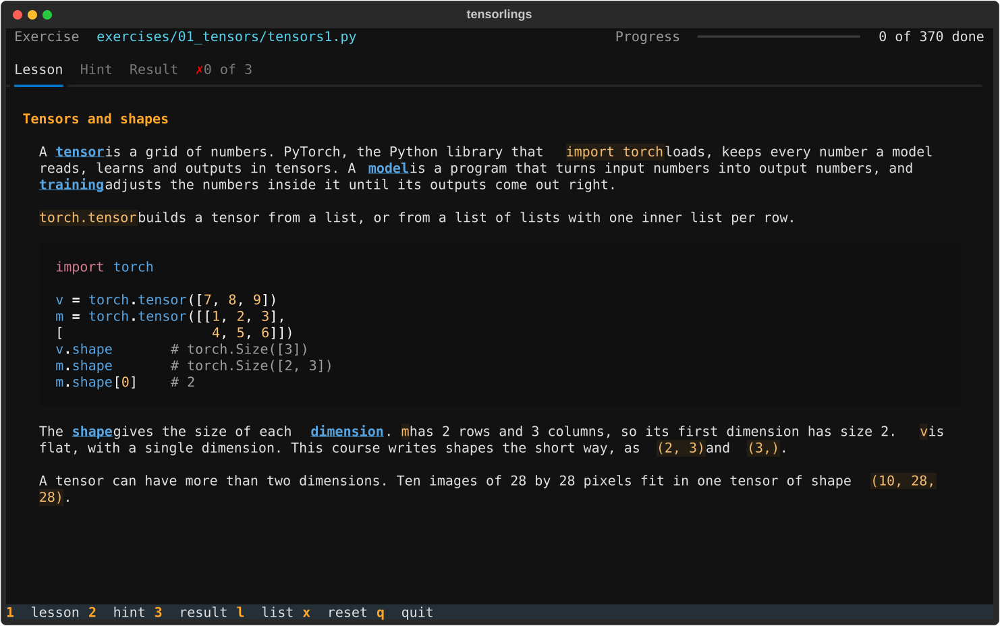

<p align="center">
  
</p>

<p align="center">
  <br>
  <a href="LICENSE"></a>
  <a href="https://www.python.org/downloads/"></a>
  <a href="https://pytorch.org/"></a>
  
  <br><br>
</p>

## Overview

A course that teaches deep learning by having you write it, one small exercise at a time. It works like [rustlings](https://github.com/rust-lang/rustlings): each exercise is a Python file with a few `TODO`s, and an app in your terminal checks your code every time you save.

It starts at tensors and derivatives, builds autograd, a GPT and a diffusion model by hand, and ends with you designing, testing and writing up a module of your own. By the end you can explain any common layer four ways: what it computes, why it exists, when to use it and how to build it from plain tensors.

There are 370 exercises in 14 sections, with 17 quizzes and a project at the end of most sections. You need to know Python. The maths and PyTorch are taught as you go.



## Features

* **Lessons beside the code:** every exercise opens on a lesson that teaches what it needs, so you never have to look anything up. Each chapter folder also has a README with further reading, which you can skip.
* **Checked on every save:** the app watches your file and reruns its checks as soon as you save, then shows the result.
* **Checks you can't fool:** your functions run on inputs the file never shows, so typing in an answer fails.
* **Errors that explain themselves:** the result has one row per function, and explains the first problem in each the way a compiler shows its first error, with the line, a plain explanation and PyTorch's own message under it.
* **A hint per function:** the hint tab has one hint for each function that doesn't pass yet, and none of them give the answer away.
* **Solutions once you pass:** passing an exercise unlocks its reference solution in `solutions/`, so you can compare it with yours.
* **Quizzes:** 17 of them close groups of chapters. Each one has no examples and nothing new, only two or three earlier moves to combine.
* **Projects on real data:** most sections end in a project, from micrograd and an exoplanet hunter to a GPT that writes Shakespeare and digits drawn from noise.
* **Runs on what you have:** the projects that train for minutes use CUDA, Apple's MPS or the CPU, whichever is best. Everything else runs on the CPU in seconds.

## What it covers

* **Foundations:** tensors, matrix multiplication, derivatives, the chain rule, autograd and backprop by hand. Project, micrograd.
* **Learning:** linear and softmax regression, gradient descent, minibatches, losses as probability, generalization. Project, an exoplanet hunter.
* **Building blocks:** linear layers, activations, MLPs, embeddings, initialization, dropout, normalization, residuals. Project, making up names.
* **Optimization:** SGD, momentum, Adam, learning rate schedules, gradient clipping, debugging training. Project, fixing a broken training run.
* **Convolutional nets:** convolution, pooling, LeNet to ResNet, upsampling and U-Net, augmentation, transfer learning. Project, finding DNA motifs.
* **Sequences:** RNNs, backprop through time, LSTMs and GRUs, encoders and decoders, causal convolutions, state space models. Project, an adder that reads.
* **Attention and transformers:** attention, masks, multi head and cross attention, positions, the transformer block, GPT-2 to Llama, mixture of experts, vision transformers, byte pair encoding. Project, a GPT that writes Shakespeare.
* **Representation learning:** word vectors, contrastive learning, masked modeling, autoencoders. Project, a map of papers.
* **Generative models:** sampling, VAEs, GANs, normalizing flows, diffusion, vector quantization. Project, digits from noise.
* **Symmetry and graphs:** sets, graphs and message passing, equivariance. Project, shortest paths.
* **Post training and RL:** fine tuning, LoRA, chat fine tuning, policy gradients, PPO, reward models, DPO. Project, post training your GPT.
* **Systems and inference:** counting cost, profiling, precision, FlashAttention, the KV cache, quantization, training on several devices, scaling laws. Project, a faster GPT.
* **Modalities:** tables, time series, audio and video as tokens, shared spaces, fusion and outputs. Project, your GPT reads signals.
* **Your own modules:** combining blocks, the design method, reproducing papers, interpretability. Projects, learned physics, an honest forecast and a module of your own.

## Install

1. Install Python 3.14 and [uv](https://docs.astral.sh/uv/).
2. Clone the repo.
   ```bash
   git clone https://github.com/ecstra/tensorlings.git
   cd tensorlings
   ```
3. Create the virtual environment and install the pinned packages.
   ```bash
   uv venv --python 3.14 .venv
   uv pip install --python .venv/bin/python -r requirements.txt
   ```
4. Write the exercise files.
   ```bash
   .venv/bin/python run.py init
   ```

Without uv, `python3.14 -m venv .venv` and `.venv/bin/python -m pip install -r requirements.txt` do the same as step 3.

## Usage

Start the course from the project folder, with your editor open beside it.

```bash
.venv/bin/python run.py
```

Fill in the code under each `TODO` and save. When every function passes, press `n` for the next exercise.

* `1`, `2` and `3`: show the lesson, the hints and the result. After each save the result shows by itself.
* `l`: list every exercise, with search and done and pending filters.
* `x`: reset the current file, after asking first.
* `q`: quit.

## Commands

Each one starts with `.venv/bin/python run.py`.

* `init`: write the exercise files, or add new ones without touching yours.
* `--manual-run`: start the course, and check only when you press `r`.
* `run [name]`: check one exercise and print the result.
* `hint [name]`: print the hints for an exercise.
* `reset name`: put an exercise file back to how it started.
* `check-all`: check every exercise and update your progress.
* `data name`: download a dataset an exercise needs, like `mnist`.
* `train name`: train a project's model for the minutes it needs, like `cifar2`.

## Datasets and checkpoints

An exercise that needs real data tells you which `data` command to run. Each dataset downloads once into `data/` and is checked against its checksum. They include MNIST, CIFAR-10, tiny Shakespeare, makemore's names and the Kepler exoplanet table.

A project that trains for minutes saves its model to `checkpoints/`, and its check loads it from there. If the checkpoint isn't there yet, the check names the `train` command to run.

## Progress

Your answers stay in `exercises/`, your unlocked solutions in `solutions/` and your progress in `.tensorlings-state.json`. Git ignores all three, along with `data/` and `checkpoints/`, so nothing of yours is ever committed.

To update, pull the repo and run `init` again. It adds any new exercises and leaves the files you have alone.

To start over, delete `exercises/`, `solutions/` and `.tensorlings-state.json`, then run `init`.

## Development

Each chapter is one module in `tensorlings/chapters/`, holding its lessons, exercise files, hints, checks and solutions. `init` writes the exercises from there, so change the chapter module rather than the file in `exercises/`.

Two scripts check the whole course. The first runs every exercise's starting file and solution through its checks and lints every lesson and hint. The second runs common wrong answers through the checks and fails if any of them pass.

```bash
.venv/bin/python run.py dev check
.venv/bin/python dev/wrong_answers.py
```

`dev/screens.py` drives the app headless and saves screenshots like the one above.

## Credits

Inspired by [rustlings](https://github.com/rust-lang/rustlings). The names and tiny Shakespeare datasets come from Andrej Karpathy's [makemore](https://github.com/karpathy/makemore) and [char-rnn](https://github.com/karpathy/char-rnn), and every dataset downloads from its original source and belongs to its makers. Everything else is by **ecstra**, under the [MIT licence](LICENSE).
