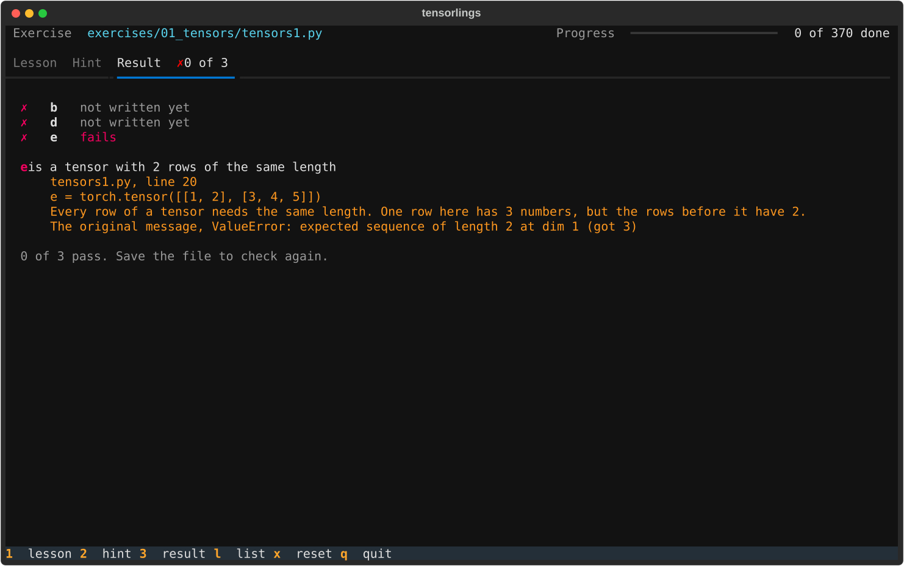

<h1 align="center">tensorlings</h1>

<p align="center">
  Small exercises that teach deep learning, from tensors up to modules of your own.
</p>

<p align="center">
  <br>
  
  
  
  
  <br><br>
  
  <br><br>
</p>

## Overview

A [rustlings](https://github.com/rust-lang/rustlings) style course for deep learning in PyTorch. Each exercise is one Python file with a few `TODO`s. You fill them in, save, and the app in your terminal checks your code straight away and tells you what's still wrong.

It starts at tensors and derivatives, builds autograd and a GPT by hand, and ends with you designing, testing and writing up a module of your own. There are 370 exercises in 14 sections, with 17 quizzes and a project at the end of most sections.

## What you learn

| Section | Topics | Projects |
|---|---|---|
| 1 Foundations | Tensors, matrix multiplication, derivatives, the chain rule, autograd | micrograd |
| 2 Learning | Linear and softmax regression, gradient descent, minibatches, losses, generalization | An exoplanet hunter |
| 3 Building blocks | Linear layers, activations, MLPs, embeddings, initialization, dropout, normalization, residuals | Making up names |
| 4 Optimization | SGD, momentum, Adam, schedules, clipping, debugging training | A broken training run |
| 5 Convolutional nets | Convolution, pooling, classic nets, U-Net, augmentation, transfer learning | DNA motifs |
| 6 Sequences | RNNs, backprop through time, LSTMs and GRUs, seq2seq, causal convolutions, state space models | An adder that reads |
| 7 Attention and transformers | Attention, masks, multi head, positions, the transformer block, modern LLMs, mixture of experts, ViT, BPE | A GPT that writes Shakespeare |
| 8 Representation learning | Word vectors, contrastive learning, masked modeling, autoencoders | A map of papers |
| 9 Generative models | Sampling, VAEs, GANs, normalizing flows, diffusion, vector quantization | Digits from noise |
| 10 Symmetry and graphs | Sets, graphs and message passing, equivariance | Shortest paths |
| 11 Post training and RL | Fine tuning, LoRA, chat fine tuning, policy gradients, PPO, reward models, DPO | Post training your GPT |
| 12 Systems and inference | Counting cost, profiling, precision, FlashAttention, the KV cache, quantization, scaling laws | A faster GPT |
| 13 Modalities | Tables, time series, audio and video as tokens, fusion, outputs | Your GPT reads signals |
| 14 Your own modules | Combining blocks, the design method, papers, interpretability | Learned physics, an honest forecast, a module of your own |

## How it works

- Every exercise opens on a lesson that teaches what it needs. You never have to look anything up.
- The app checks your file every time you save. It runs your functions on inputs the file never shows, so hardcoding an answer fails.
- The result shows one row per function, and explains the first problem in each one the way a compiler would.
- The hint tab has one hint for each function that doesn't pass yet.
- Once an exercise passes, its reference solution is unlocked in `solutions/`.
- The projects that train for minutes run on the best device you have: CUDA, Apple's MPS or the CPU. Everything else runs on the CPU in seconds.

<p align="center">
  
</p>

## Install

1. Install Python 3.14 and [uv](https://docs.astral.sh/uv/).
2. Clone the repo.
   ```bash
   git clone https://github.com/ecstra/tensorlings.git
   cd tensorlings
   ```
3. Create the virtual environment and install the pinned packages.
   ```bash
   uv venv --python 3.14 .venv
   uv pip install --python .venv/bin/python -r requirements.txt
   ```
   Without uv, `python3.14 -m venv .venv` and `.venv/bin/python -m pip install -r requirements.txt` do the same.
4. Write the exercise files.
   ```bash
   .venv/bin/python run.py init
   ```

## Usage

Start the course, and keep your editor open beside it.

```bash
.venv/bin/python run.py
```

| Command | What it does |
|---|---|
| `run.py` | Start the course |
| `run.py --manual-run` | Start the course, and check only when you press `r` |
| `run.py init` | Write the exercise files, or add new ones without touching yours |
| `run.py run [name]` | Check one exercise and print the result |
| `run.py hint [name]` | Print the hints for an exercise |
| `run.py reset name` | Put an exercise file back to how it started |
| `run.py check-all` | Check every exercise and update your progress |
| `run.py data name` | Download a dataset an exercise needs, like `mnist` |
| `run.py train name` | Train a project's model for the minutes it needs, like `cifar2` |

### Keys

- `1`, `2` and `3` show the lesson, the hints and the result. After each save the result shows by itself.
- `n` goes to the next exercise once every function passes.
- `l` lists every exercise, with search and done and pending filters.
- `x` resets the current file, after asking first.
- `q` quits.

## Datasets and checkpoints

Exercises that need real data tell you which `run.py data` command to run. Each dataset downloads once into `data/` and is checked against its checksum. The datasets are MNIST, CIFAR-10, tiny Shakespeare, makemore's names, the Kepler exoplanet table and a few smaller ones.

Projects that train for minutes save their model to `checkpoints/`, and their check loads it from there. If a check can't find its checkpoint, it names the `run.py train` command to run.

## Your progress

Your progress stays on your machine. Your answers in `exercises/`, the solutions you've unlocked in `solutions/`, the progress file `.tensorlings-state.json`, `data/` and `checkpoints/` are all ignored by git. To start over, delete them and run `run.py init` again.

## Development

The course lives in the `tensorlings/` package. Each chapter is one module in `tensorlings/chapters/`, holding its lessons, exercises, hints, checks and solutions. `run.py init` writes the exercise files from there, so edit the chapter module and not the file in `exercises/`.

Two checks cover the whole course.

```bash
.venv/bin/python run.py dev check       # every solution passes, every lesson and hint follows the course's rules
.venv/bin/python dev/wrong_answers.py   # common mistakes are all rejected
```

`dev/screens.py` drives the app headless and saves screenshots, which is how the images above were made.

## Credits

Inspired by [rustlings](https://github.com/rust-lang/rustlings). The names and tiny Shakespeare datasets are from Andrej Karpathy's [makemore](https://github.com/karpathy/makemore) and [char-rnn](https://github.com/karpathy/char-rnn). Every dataset downloads from its original source and belongs to its makers. Everything else is by **ecstra**.
